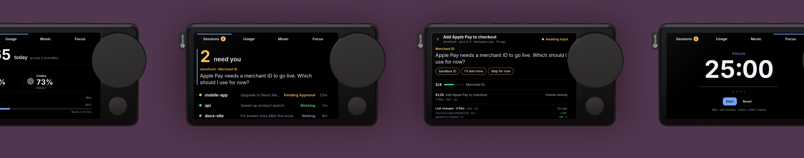
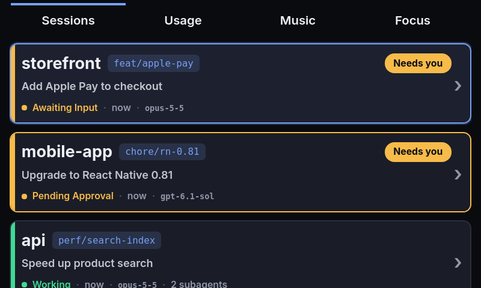
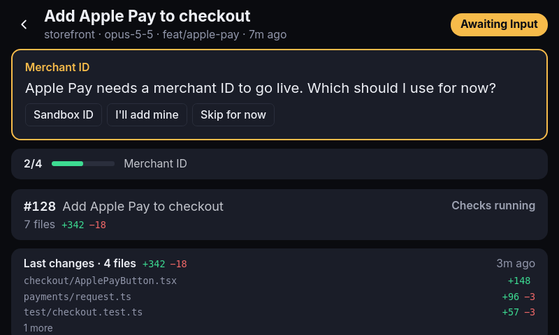
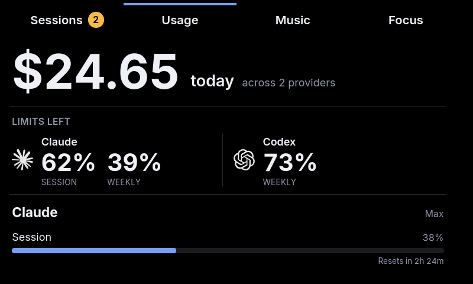
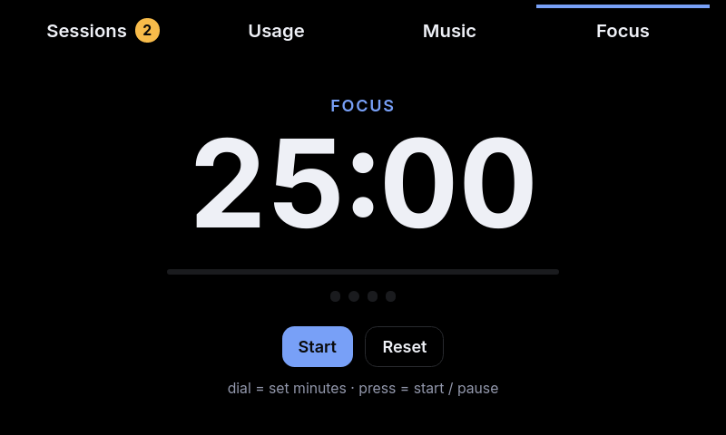
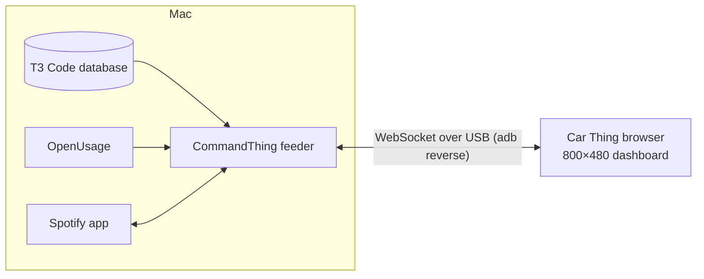

# CommandThing

**Turn a Spotify Car Thing into a desk display for your AI coding agents.**



CommandThing shows every agent thread running in [T3 Code](https://t3.codes) on a small screen
beside your keyboard. You can see at a glance which threads are working, which ones are blocked on
you, and which ones finished, without switching windows on your Mac. The dial and buttons on the
device let you open a thread and read what it is doing.

Spotify discontinued the Car Thing in December 2024. With community firmware, it becomes an
800×480 touchscreen with a dial, physical buttons and a USB cable. That is enough for a dashboard that
stays on all day.

## What it shows

| | |
|---|---|
|  |  |
| **Sessions.** A huge count of threads that need you, with the first one's actual question, readable from across the desk. Every other thread sits on one line with its status and age. | **Session detail.** What the thread needs from you or is doing right now, its task progress, linked pull requests with their checks, the files it last changed, and a condensed timeline. |
|  |  |
| **Usage.** Today's spend and the limits you have left across AI providers, with reset countdowns. | **Focus.** A Pomodoro timer you set with the dial. |

There is also a **Music** page with Spotify's now playing, album art, synced lyrics and playback
controls.

When a thread starts waiting for you, a notification slides in on whatever page is open.

## How it works



1. **The feeder** is a small Node.js service that runs in the background on your Mac. It reads T3
   Code's own SQLite database in read-only mode, so the board shows exactly what T3 Code's sidebar
   shows. It also polls [OpenUsage](https://github.com/robinebers/openusage) for usage and controls Spotify through
   AppleScript.
2. **The tunnel** keeps an `adb reverse` port forward alive, so the device can reach the feeder at
   `localhost:4000` over the USB cable. Nothing is exposed to your network.
3. **The dashboard** is a React app built for the Car Thing's old Chromium 69 browser. It receives
   all state over one WebSocket and loads album art through the feeder, because the device has no
   internet connection.

CommandThing never writes to T3 Code. To answer a question or approve a command, use T3 Code on
your Mac.

## Controls

| Control | What it does |
|---|---|
| Dial | Scroll, or move between sessions |
| Dial press | Open the selected session, start or pause the timer |
| Back button | Go back to the board |
| Preset buttons 1–4 | Jump to Sessions, Usage, Music or Focus |
| Settings button | Open settings |

The touchscreen works too.

## Requirements

- A Car Thing running community firmware with ADB enabled, such as [Thing Labs](https://thinglabs.sh/).
  See [Device setup](docs/device-setup.md).
- macOS with Node.js 26 or newer, and Android platform tools (`adb`).
- [T3 Code](https://t3.codes) running on the same Mac.
- Optional: [OpenUsage](https://github.com/robinebers/openusage) for the Usage page, and the Spotify
  desktop app for the Music page.

## Quick start

```bash
npx commandthing@latest setup
```

Setup installs a self-contained runtime under `~/.commandthing` and starts the feeder and tunnel as
background services. The device's browser must load `http://localhost:4000`; see
[Device setup](docs/device-setup.md). Open <http://localhost:4000> to see
the same dashboard in your browser.

Check that everything is running:

```bash
~/.commandthing/bin/commandthing status
```

## Repository layout

```text
apps/
  dashboard/       React + Vite UI compiled for Chromium 69
  feeder/          Node.js host service and WebSocket server
packages/
  cli/             CLI, installed runtime sources, and runtime build tooling
  protocol/        Shared dashboard/feeder wire contracts
docs/              Installation, architecture, development, and release guides
```

pnpm manages the workspace. The published CLI bundles the feeder, tunnel, device controller and
diagnostics, so installed users only need Node.js.

## Documentation

- [Getting started](docs/getting-started.md)
- [Device setup](docs/device-setup.md)
- [Configuration and local data](docs/configuration.md)
- [CLI](docs/cli.md)
- [Architecture](docs/architecture.md)
- [Development](docs/development.md)
- [Troubleshooting](docs/troubleshooting.md)
- [Publishing and releases](docs/publishing.md)
- [Brand assets](docs/brand-assets.md)

## Security

The feeder binds to `127.0.0.1` by default because its session, usage and media endpoints have no
authentication. The device reaches it through the USB tunnel. Binding to your LAN is an explicit
advanced setting; see [Security](SECURITY.md).

## License and naming

[MIT](LICENSE). CommandThing is independent software for discontinued Spotify Car Thing hardware.
Spotify is not affiliated with or responsible for this project. The screenshots use made-up demo
data. The device photo at the top is a Spotify press image with CommandThing screens placed on it.
